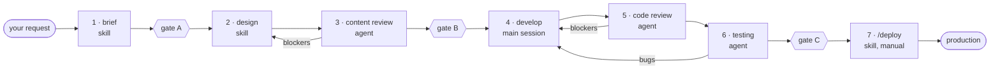

# Change pipeline

Every change to the site goes through seven phases, from "why are we doing this" to "it's live and verified". You start it with one command and approve it at three gates; Claude runs the rest.

```
/ship add a "now learning" section to the home page
```

## Skills or agents? The rule this pipeline uses

- **Skills** run in your main conversation. They are for phases where **you need to be in the loop**: deciding what to build, choosing a design, approving a merge. Subagents can't ask you questions mid-task, so these can't be agents.
- **Agents** run in their own context with their own tools. They are for phases that need an **independent second opinion**: content review, code review, testing. The reviewer never saw the work being made, so the work never grades itself. Their logs and test output also stay out of your main conversation.
- **Deploy is a skill only you can trigger** (`disable-model-invocation: true`), so Claude never decides on its own to ship.



## Commands

| Command | What it does |
|---|---|
| `/ship <change>` | Start a change. Runs phases 1–6, stopping at gates A and B. |
| `/ship continue [id]` | Resume a change, in this or any later session. |
| `/ship status` | List changes and where each one is. |
| `/deploy [id]` | Phase 7: push, PR, preview smoke test, merge (after your yes), production check. |
| `/product-brief <idea>` | Just think a change through, without starting the pipeline. |
| `/design-phase <folder>` | Re-run design for a change. |
| `@"code-reviewer (agent)"` | Ask for a review any time, outside the pipeline. Same for `content-editor` and `qa-tester`. |

## Phases

| # | Phase | Type | Output | Gate |
|---|---|---|---|---|
| 1 | Product brief | skill `product-brief` | `brief.md` with testable acceptance criteria | **A: you approve the brief** |
| 2 | Design | skill `design-phase` (+ `design-system`, `frontend-design`) | `design.md` with copy deck | |
| 3 | Content review | agent `content-editor` (+ `brand-voice`) | `content-review.md` | **B: you approve design + copy** |
| 4 | Development | main session, on a `claude/<slug>-<id>` branch | code, e2e specs, `dev-notes.md` | |
| 5 | Code review + validation | agent `code-reviewer` (+ Vercel React rules, Web Interface Guidelines) | `code-review.md` | |
| 6 | Testing | agent `qa-tester` (+ Playwright MCP, `design-system`) | `qa-report.md`, screenshots, new specs | **C: ready for `/deploy`** |
| 7 | Deployment | skill `deploy`, manual only | PR, `preview-smoke.md`, `prod-smoke.md`, `deploy.md` | asks before merging |

Reviews and tests loop automatically: blockers go back to the previous step, up to 3 rounds, then Claude stops and asks you. Small changes get small phases, but no phase is skipped unless you say so (and the skip is recorded).

Every change gets a folder in `docs/changes/` (see its README). `status.md` in that folder is the source of truth, which is what makes `/ship continue` work across sessions.

## Guardrails

- **Reviewers can't edit your code.** Each agent has a `PreToolUse` hook (`.claude/hooks/write-guard.mjs`) that blocks writes outside its allowed folders: `content-editor` and `code-reviewer` may only write their own memory; `qa-tester` may also write `e2e/` specs and change-folder evidence. (A guardrail, not a sandbox: shell commands aren't covered.)
- **No accidental production deploys.** `.claude/settings.json` denies pushing to `main`, force-pushing, and `vercel --prod` / `vercel promote`, and makes `gh pr merge` ask you first. Production only happens by merging a reviewed PR.
- **Secrets stay unread.** The same settings deny reading `.env` and `.env.local`.
- **Agents remember.** All three agents have project memory (`.claude/agent-memory/<agent>/`), so recurring issues and flaky tests get noticed faster over time. Commit it so it travels with the repo.

## What came from where

Picked from the most-used, maintained sources, and vendored into `.claude/skills/` so they work offline, in Claude Code on the web, and can be preloaded into agents by name.

| Piece | Source | Used in | Why |
|---|---|---|---|
| `frontend-design` | Anthropic, `anthropics/skills` (Apache-2.0) | design | The most-installed design skill; pushes for deliberate, non-templated choices. |
| `vercel-react-best-practices` | Vercel, `vercel-labs/agent-skills` (MIT) | code review | 70 React/Next.js performance rules from Vercel Engineering, ranked by impact. |
| `web-design-guidelines` | Vercel, `vercel-labs/agent-skills` (MIT) | code review | Audits UI code against Vercel's Web Interface Guidelines (a11y, focus, forms, motion). Fetches the latest rules each run. |
| Playwright MCP | Microsoft, `@playwright/mcp` | testing | Real-browser driving with accessibility snapshots; configured only inside `qa-tester`, so its tools don't crowd your main session. |
| `ship`, `product-brief`, `design-phase`, `deploy`, `brand-voice`, `design-system`, the 3 agents | written for this repo | all | Generic versions don't know your CSP, `bio.md` grounding, Gemini endpoint, voice, or tokens. |

Each vendored folder has a `SOURCE.md` with the upstream commit. To update one, copy it again from upstream.

**Considered and left out on purpose**
- **Superpowers** and Anthropic's **feature-dev** plugin: both are full plan → build → review workflows. Running one alongside `/ship` would give Claude two competing processes. Good to study, not to stack.
- **VoltAgent's 100+ subagent collection**: broad and generic; three agents tuned to this repo beat thirty that aren't.
- **Vercel `deploy-to-vercel`**: built for CLI/claimable deploys; your setup is git-push previews, which is safer.

**Optional add-ons**
- `security-guidance` plugin (official marketplace): warns as risky patterns are written. `/plugin install security-guidance@claude-plugins-official`
- `skill-creator` plugin: measure and tune these skills once you've used them a few times.
- Vercel MCP (`https://mcp.vercel.com`): lets `/deploy` read preview build logs directly.
- `@axe-core/playwright` as a dev dependency: automated WCAG checks inside your e2e specs. A good first `/ship` candidate.

## Works with your ECC setup

Your Everything Claude Code skills (listed in `CLAUDE.md`) still load as before. The pipeline names its own agents and skills explicitly, so there's no ambiguity with ECC's similarly named agents, which stay available under their plugin prefix.

## Customize

- `brand-voice/SKILL.md`: a starter drawn from your current copy. Make it yours; every content review uses it.
- `design-system/SKILL.md`: update when `@theme` changes.
- Agent `model:` fields: `code-reviewer` inherits your session model; the other two use Sonnet to save usage.
- Production URL: set once at the top of `CLAUDE.md`; `/deploy` reads it from there.
- Gates and loop limits live in `ship/SKILL.md`.
- Subagents run in the background by default, and `/ship` waits for each report before moving on. If you'd rather watch them block, set `CLAUDE_CODE_FORK_SUBAGENT=0` in your user settings.

## Found while setting this up

- `npm run lint` fails: Next.js 16 removed `next lint`. The pipeline skips lint until it's fixed.
- `CLAUDE.md` said CI runs on every push, but the workflow was removed in `a8bb69f`. Updated.
- `.claude/` was entirely gitignored, which would keep the pipeline off GitHub and out of web sessions. `.gitignore` now commits agents, skills, hooks, settings and agent memory, and still ignores local settings.

Suggested first run: `/ship fix npm run lint for Next 16 with an ESLint flat config`. It's small, real, and exercises every phase.
